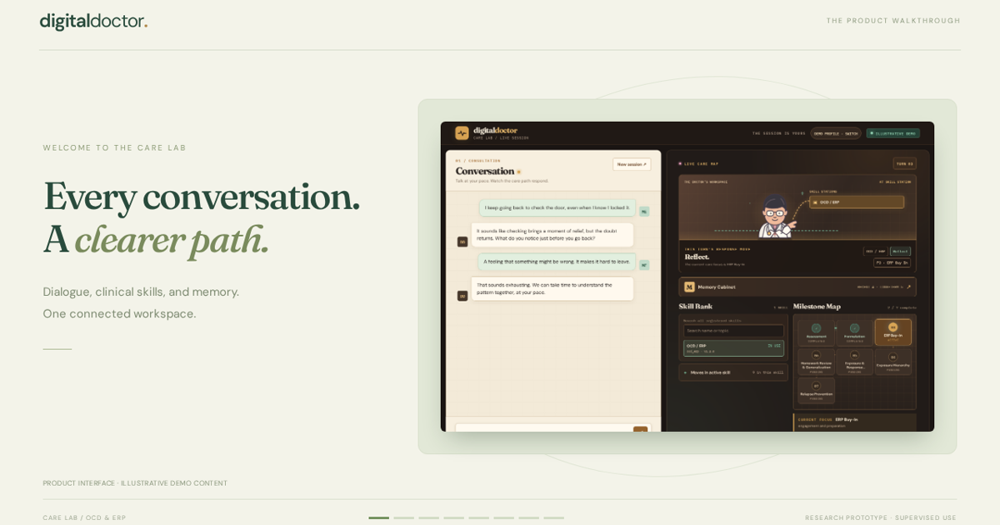

# Digital Doctor · Platform Demo

A concise English showcase of the [Digital Doctor Care Lab](https://digital-therapist.azurewebsites.net/), with a 60 second product film and an interactive tour of six modules.

**[View the demo →](https://yyifan-onyen.github.io/digital-therapist-demo/)** · **[Open the platform →](https://digital-therapist.azurewebsites.net/)**



## What's inside

- **Conversation:** a focused dialogue area alongside the care workspace.
- **Live Care Map:** the current skill, selected response move, and care guide.
- **Skill Bank:** searchable registered skills and active response moves.
- **Milestone Map:** completed, active, and upcoming care phases.
- **Memory Cabinet:** recent dialogue, continuity summaries, topics, and reminders.
- **Case Formulation:** structured notes on concerns, triggers, and recurring patterns.

The video is a silent, captioned product tour. English captions, a text transcript, and the downloadable MP4 are included. Screenshots use synthetic demo content; no real account records or conversations are published.

## Run locally

No build step, package installation, API key, or backend is needed.

```sh
python3 scripts/serve.py
```

Open `http://localhost:4173`. To verify the assets:

```sh
python3 scripts/check_site.py
```

The preview server supports video seeking through HTTP byte ranges. Optional browser checks use `python3 scripts/browser_check.py` with Playwright installed; pass a URL to check a deployed copy.

## Publish

GitHub Pages uses the `Publish demo` workflow on pushes to `main`. The workflow verifies the site and publishes only `index.html`, `styles.css`, `app.js`, `.nojekyll`, and `assets/`. Repository settings must select **GitHub Actions** as the Pages source.

## Update the film or screenshots

Optional authoring dependencies: Python 3.10+, Playwright with Chromium, and FFmpeg with `libx264`.

```sh
python3 -m pip install playwright
python3 -m playwright install chromium --only-shell
python3 scripts/capture_product.py
python3 scripts/render_video.py
python3 scripts/check_site.py
```

`capture_product.py` fetches the public UI and intercepts every product API request with synthetic fixtures. It does not open a real profile, send messages, reset sessions, call a model, or import platform code. `render_video.py` uses only the exported screenshots. Generated working files stay in the ignored `.qa/` directory.

To replace the film, update `assets/digital-doctor-walkthrough.mp4`, its English `.vtt` captions, the poster, duration labels, and transcript together.

This repository is an independent static presentation. Digital Doctor is a research prototype for supervised use; the showcase does not establish clinical efficacy.
